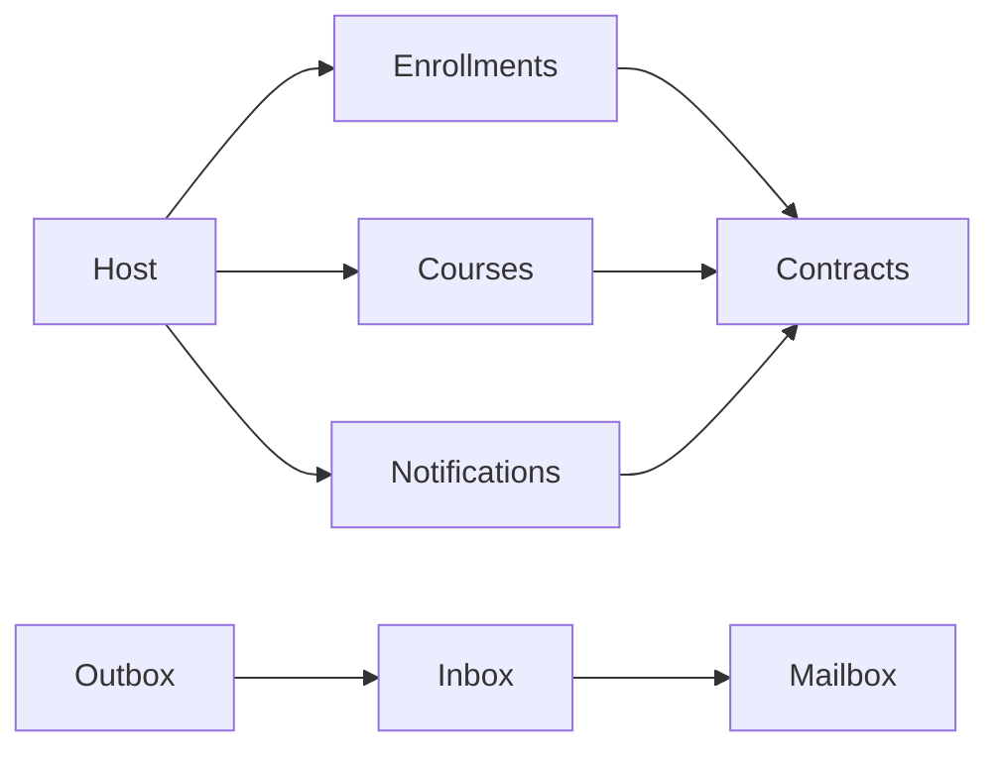

# Modular Monolith & Event-Driven Systems — .NET 10

A focused reference from [Rehan Akbar](https://www.rehanakbar.dev/templates). MIT.

## Run
Requires .NET SDK 10.0.402 and Docker Linux containers.

```sh
docker compose up -d --wait
dotnet run --project src/Host --urls http://127.0.0.1:5080
```

Create a course with POST /courses and JSON {"title":"Architecture","capacity":2}. Enrol with POST /courses/COURSE_ID/enrollments and {"studentId":"11111111-1111-4111-8111-111111111111"}. The returned id is also the event ID. After the background relay runs, GET /notifications/EVENT_ID returns {"deliveries":1,"effects":1}. Notifications are database mailbox rows, not real emails.

## Verify

```sh
dotnet restore EduCore.slnx --locked-mode
dotnet test EduCore.slnx
```

Tests require PostgreSQL and run HTTP integration, concurrent capacity, module dependency, and crash-after-consumer-commit scenarios. TEST_POSTGRES can point to a separate disposable database. Tests do not delete your database.

## Boundaries
Courses, Enrollments and Notifications are separate assemblies. They reference Contracts, never another module assembly. Each owns a PostgreSQL schema. The host composes implementations. The course-seat contract deliberately shares a relational transaction so seat reservation, enrolment and the outbox insert commit together. This is a modular monolith trade-off, not independent microservice databases.



The relay claims one pending row with FOR UPDATE SKIP LOCKED. The consumer commits its inbox and business effect in its own transaction. Only then does the relay acknowledge the outbox row. A process crash between those commits causes redelivery; the inbox prevents a duplicate business effect. The crash test calls the relay's injected crash point directly: no public crash endpoint exists. Multiple relay workers can claim different rows.

## Limits / security
Unauthenticated local demonstration: do not expose the host publicly without authentication, authorisation, TLS, rate limits and operational review. All data values use SQL parameters. The compose password is a loopback-only demonstration value. Schema bootstrap is for disposable development databases; use reviewed migrations in long-lived environments. Delivery log/inbox retention, poison-message parking, lease timeouts, ordering, monitoring, a real message broker and external email side effects are outside this reference. The background loop handles one event per second. Database exceptions are sanitised in HTTP responses.

## Reset
Stop the host and run docker compose down -v to delete this kit's disposable data. All three .NET references use loopback port 5434; run one compose stack at a time.
